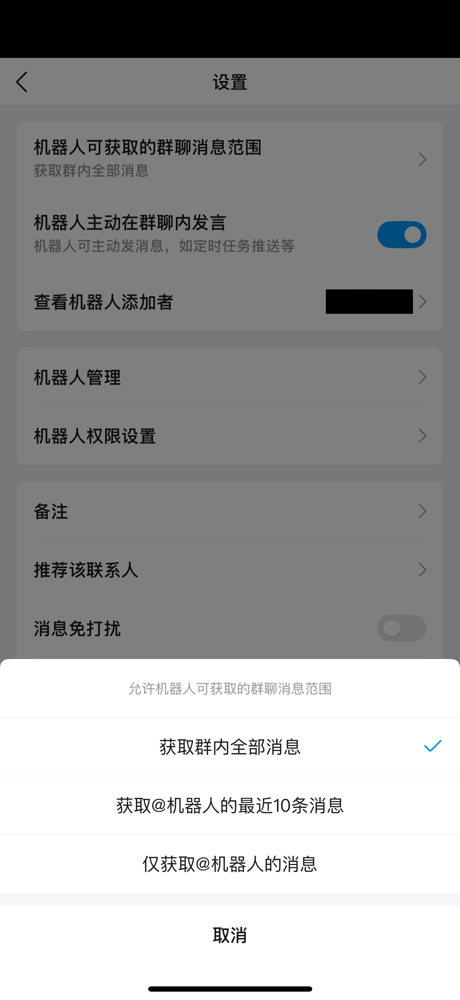
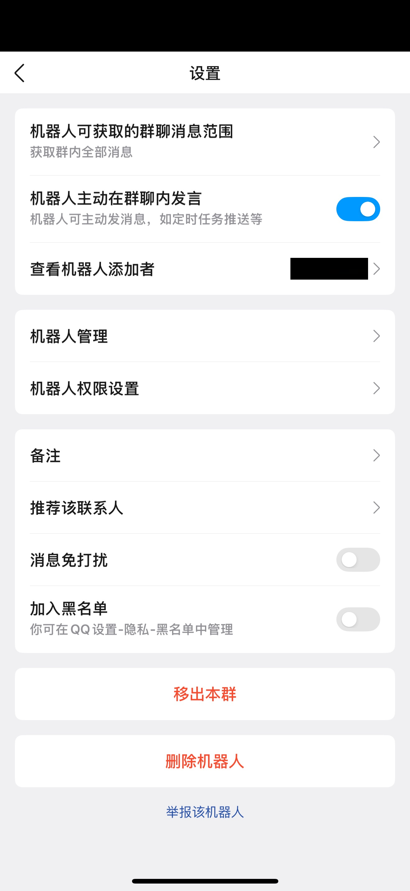

<div align="center">


**基于 [deepseek-harness](https://github.com/deepseek-ai/deepseek-harness) (dsh) 的 QQ Bot 插件，将 DeepSeek AI 助手接入 QQ 私聊与群聊。**

[](https://www.npmjs.com/package/@tencent-connect/dsh-qqbot)
[](./LICENSE)
[](https://github.com/tencent-connect/dsh-qqbot)
[](https://bot.q.qq.com/wiki/)

<br/>

**[English](./README_EN.md) | 简体中文**

扫码加入 QQ 群 / 频道

<table>
<tr>
<td align="center" width="50%"><br /><b>QQ 开发者交流群</b><br /><sub>1群: 1032635674 · 2群: 1056948758</sub></td>
<td align="center" width="50%"><br /><b>QQ 开发者社区频道</b><br /><sub>频道号: 20dnumts4z</sub></td>
</tr>
</table>

</div>

## 架构

```
QQ 用户 → QQ WebSocket → dsh-qqbot → ctx.agents → dsh agent loop → LLM
                                 ↑                           │
                                 └── session/event ──────────┘
                                       (assistant reply → QQ sendMarkdown)
```

## 安装

### 方式一：桌面版安装（推荐）

无需命令行，全程在应用内完成：

1. **安装**：左侧栏点击「插件」→「添加插件」→ 输入 `@tencent-connect/dsh-qqbot@latest` → 安装并立即启动


2. **连接**：打开左侧的「QQ 机器人」工作台，用手机 QQ 扫码连接。已有机器人时，点击机器人列表顶部的「＋」继续添加。

扫码成功后凭据自动保存，后续启动无需再次扫码。

主包会安装同版本的「QQ 消息记录」。在插件详情的「包含的组件」中可单独停用记录界面，机器人仍会按会话设置保存消息。

### 方式二：手动执行

```bash
# 安装到 profile
npx @deepseek-ai/dsh plugin --profile qqbot add @tencent-connect/dsh-qqbot

# 启动
npx @deepseek-ai/dsh --profile qqbot
```

首次启动时，插件检测到凭据未配置会自动进入扫码引导：终端输出二维码 → 手机 QQ 扫码绑定 → 凭据自动保存到 profile，后续启动无需再次扫码。

无端内绑定页的环境（如纯 CLI）可设置 `QQBOT_BIND_OPEN_BROWSER=1`，额外拉起系统浏览器扫码页作为降级通道。


> **提示**：建议升级至 `0.4.0` 以上版本扫码，支持点击链接在浏览器打开，避免部分终端二维码渲染错位的问题。

### 方式三：本地路径安装

```bash
# 构建
cd /path/to/dsh-qqbot
pnpm install && pnpm build

# 安装到 profile（本地路径）
npx @deepseek-ai/dsh plugin --profile qqbot add /path/to/dsh-qqbot

# 启动
export QQBOT_APPID="你的AppID" QQBOT_SECRET="你的AppSecret"
npx @deepseek-ai/dsh --profile qqbot
```

### 方式四：--patch 开发模式

```bash
export QQBOT_APPID="你的AppID" QQBOT_SECRET="你的AppSecret"
npx @deepseek-ai/dsh web --patch /path/to/dsh-qqbot/cordis.dev.yml
```

### 从官方 0.5.5 升级

先退出该 profile 的 Host，并备份它的 `cordis.patch.yml` 与 `~/.dsh-qqbot/model-prefs.json`。在原 profile 安装新版后直接启动。QQBot 沿用绑定及群聊、私聊名单，按 AppID 导入模型、预设和当前 Session 关联。关联需通过当前 Host 的 Session 持久化校验。原 Session 和工作目录继续通过 DSH 打开。

旧配置省略 `access.commandMode` 时，斜杠命令默认采用「所有人」。获准接入的发送者适用相同的命令授权规则。可以在「斜杠命令」中选择独立的命令白名单或关闭。

设置、记录与投递凭证默认位于当前 profile 的 `qqbot-state/`。可用 `QQBOT_DATA_DIR` 指定独立的绝对路径。另一 Host 已占用同一实际目录时，请先退出占用进程或改用独立 profile 和目录。

回退时退出 Host，重新安装 `@tencent-connect/dsh-qqbot@0.5.5`，恢复备份的 profile 配置，再启动。同一 profile 的旧偏好文件仍可供 0.5.5 读取。

### DSH 宿主能力

| 已验证的宿主 | QQ 收发 | QQ 工作台与记录组件 | 标准与 PTC 自定义工具 |
| --- | --- | --- | --- |
| 官方 `0.1.0-rc.8`（按发布版本固定 Cordis 依赖） | 支持 | 需要宿主提供 Fetch 和 UI 接口 | 需要升级 |
| 官方 `0.2.2-rc.3` | 支持 | 支持 | 需要升级 |
| 提供可撤销作用域执行器与派发守卫的宿主 | 支持 | 支持 | 支持 |

缺少工具权限接口时，已有受限 QQ 会话会暂停执行，并在工作台显示原因。可切回原生工具设置，或升级支持该接口的宿主。

## 配置项

| 配置 | 类型 | 默认值 | 说明 |
|------|------|--------|------|
| `appId` | string | **必填** | QQ Bot AppID（或通过 `QQBOT_APPID` 环境变量） |
| `appSecret` | string | **必填** | QQ Bot AppSecret（或通过 `QQBOT_SECRET` 环境变量） |
| `provider` | string | `deepseek-official` | LLM 提供商名称 |
| `model` | string | `deepseek-chat` | 模型名称 |
| `preset` | string | - | Agent preset id |
| `cwd` | string | `process.cwd()` | Agent 工作目录 |
| `requireMention` | boolean | `true` | 群聊是否需要 @bot 才触发 |
| `groupPrompt` | string | - | 群聊额外 system prompt |
| `directPrompt` | string | - | 私聊额外 system prompt |
| `textChunkLimit` | number | `4500` | 单条消息最大字符数 |
| `streaming` | boolean | `true` | 是否启用流式输出（群聊始终不启用） |
| `sessionIdleTimeout` | number | `1800000` | 会话闲置超时(ms)，默认 30 分钟；`<=0` 表示不回收 |
| `processingTimeoutMs` | number | `1800000` | 处理超时(ms)，超时中断当前 LLM 调用 |
| `maxQueue` | number | `20` | 并发队列最大长度 |
| `historyLimit` | number | `10` | 群历史缓冲条数 |
| `askTimeoutMs` | number | `300000` | 待答问题超时(ms)，默认 5 分钟（ask_user_question） |
| `showToolResults` | boolean | `false` | 是否展示工具调用成功结果。整轮失败时只发送简短提示 |
| `debug` | boolean | `false` | 调试模式 |

### 访问控制（access）

| 配置 | 类型 | 默认值 | 说明 |
|------|------|--------|------|
| `access.c2cMode` | `open`/`allowlist`/`disabled` | `open` | 私聊访问模式 |
| `access.c2cAllow` | string[] | `[]` | 私聊白名单（user openid） |
| `access.groupMode` | `open`/`allowlist`/`disabled` | `open` | 群聊访问模式 |
| `access.groupAllow` | string[] | `[]` | 群聊白名单（group openid） |
| `access.commandMode` | `open`/`allowlist`/`disabled` | `open` | QQ 斜杠命令模式，白名单按发送者 OpenID 独立校验 |

QQ 斜杠命令与群聊、私聊共用“所有人／白名单／关闭”模式：先按接入规则进入对话，再按发送者身份校验命令；审批和提问按钮沿用各自鉴权。命令白名单保存在独立的身份文件中，切换模式不影响名单。

三类名单（私聊、群、命令）均支持三种添加方式：**配对码**、**手动按 OpenID 批量添加**、**导出/复制**。注意 OpenID 不是 QQ 号或群号；拿不到 OpenID 时用配对码添加。

- **配对码**：在账号设置中生成，让用户在对应对话里直接发给机器人即可加入名单。同一码可连续添加多人，错误场景（群码发到私聊等）不影响其有效性。
- **撤销语义**：移除身份后，移除前生成的同类配对码不能将其重新加回，重新授权需生成新码；其余人仍可继续认领。

配置接口的 GET 返回 `config.accessRevision`，更新 `access` 时应一并提交该值；名单或模式已变化时返回 409，不覆盖现有授权。

### QQ 群消息范围与主动发言

请群主在手机 QQ 的群聊中打开该机器人的设置，按需配置以下权限。每个群分别设置。

| 手机 QQ 设置 | DSH 中的行为 |
|---|---|
| 「机器人可获取的群聊消息范围」→「获取群内全部消息」 | QQ 可推送后续未 @ 机器人的普通群消息。群获准接入、开启「接收 QQ 消息」且启用本机消息记录时，工作台会记录收到的消息。启用「群聊仅回复 @机器人的消息」时，普通消息可以进入近期上下文，但不会单独启动 Agent。工作台从收到的消息开始记录，不补拉群历史。 |
| 「机器人主动在群聊内发言」 | 允许机器人在没有可用回复凭据时发消息。工作台直接发送时优先使用可用的回复凭据。QQ 侧授权与网页回答是否自动推送分别配置。 |




截图已遮盖手机状态栏和机器人添加者的昵称。

QQ 工作台支持独立启停记录组件，右侧会话设置也可由扩展注册分组。见 [QQ 工作台扩展](./docs/workbench/extensions.md)。

### 主动推送（proactiveDelivery）

QQ 入站触发的回合始终被动回复；定时任务等服务回合始终主动推送到 QQ。下表只控制「非 QQ 输入（如桌面续聊 QQ 会话）」的回合：

| 配置 | 类型 | 默认值 | 说明 |
|------|------|--------|------|
| `proactiveDelivery.externalTurns` | `off` / `c2c` / `all` | `all` | 关闭、仅私聊或同时推送私聊和群聊，适用于网页续聊和网页补答 |

### 回合来源与投递防重

QQ 提问通过原生 `followup` 进入 Inbox。同一群或联系人的输入按到达顺序排队。入站回执绑定平台消息、发送者、Session、回复目标和正文摘要。编辑、删除或重新排队会撤销原回执。重启后无法验证来源的待处理输入也会停止 QQ 自动投递。

群聊在本轮结束并确认 Session 落盘后发送最终答复，整轮失败时发一条简短提示。QQ 回合混入网页输入后停止后续自动投递。私聊流式、工具结果、最终正文和文件共用来源与接入检查。QQ 会话中的文件工具使用本轮已验证的对话目标。独立 DSH 会话可显式指定允许的目标，发送前会检查文件路径。

插件数据目录下的账号独立 `delivery-*.jsonl` 只保存输入关联、摘要和发送操作状态，不保存聊天正文。提交前持久登记，重复事件、重载和重启不主动重发或重新入队。每个流式请求和文件上传后的发送都会复查权限。首个流式帧因回复目标过期而明确被拒时，沿用原有静态回复路径。提问卡片只有在平台明确拒绝时才改为纯文本，同一道题共用一个投递标识。结果未知时停止自动发送。接口接受只表示 QQ 平台接受请求。

请随 profile 数据一起保留账本。记录损坏或不完整时停止发送，并保留原账本。手动发送明确被平台拒绝时，可用原操作重试。状态为「发送结果未知」时请先在 QQ 核对。

### 富媒体理解（media）

| 配置 | 类型 | 默认值 | 说明 |
|------|------|--------|------|
| `media.enabled` | boolean | `true` | 是否启用富媒体理解（图片/视频下载 + 工具分析） |
| `media.maxMB` | number | `200` | 富媒体下载大小上限(MB) |
| `media.ttlHours` | number | `24` | 富媒体存活时长(小时)，0=永不过期 |

### 视觉理解（vision）

| 配置 | 类型 | 默认值 | 说明 |
|------|------|--------|------|
| `vision.enabled` | boolean | `false` | 是否启用视觉理解（qqbot_describe_image 工具） |
| `vision.provider` | string | - | 视觉模型 provider（如 pi-ai） |
| `vision.model` | string | - | 视觉模型 id（如 qwen-vl-max） |
| `vision.maxBytes` | number | `10MB` | 图片字节上限 |
| `vision.maxTokens` | number | `1024` | 输出 token 上限 |
| `vision.timeoutMs` | number | `120000` | 视觉调用超时(ms) |

### 附件发送（sendFile）

| 配置 | 类型 | 默认值 | 说明 |
|------|------|--------|------|
| `sendFile.restrictPaths` | boolean | `true` | 是否启用路径白名单（仅 media + cwd + extraRoots） |
| `sendFile.extraRoots` | string[] | `[]` | 额外允许访问的根目录 |

## 内置命令

| 命令 | 说明 |
|------|------|
| `/new`（别名 `/reset` `/clear`） | 开始新会话（清空上下文） |
| `/compact` | 压缩会话历史（摘要替换旧记录，保留上下文） |
| `/model` | 查看或切换模型 |
| `/effort [档位]` | 查看当前推理强度与可选档位，空闲时为当前 Session 设置档位。用 `/effort default` 恢复模型默认值 |
| `/preset` | 查看或切换 agent preset（新会话生效） |
| `/stop` | 中止当前生成 |
| `/bot-ping` | 网络延迟检测（返回传输与处理耗时） |
| `/bot-version` | 查看版本信息 |
| `/bot-me` | 查看自己的 OpenID，群聊中同时显示群 OpenID |
| `/bot-status` | 查看模型、推理强度、生成状态、排队消息数和上下文占用估算 |
| `/bot-help` | 查看所有指令 |

## 核心模块

```
src/
├── index.ts                    # Cordis 插件入口（async apply）
├── config.ts                   # 配置 Schema
├── types.ts                    # 全局类型定义
├── setup/                      # 凭据绑定（扫码）
│   ├── index.ts                # 绑定编排（ensureCredentials）
│   ├── binding-service.ts      # 扫码状态机（宿主内唯一事实源）
│   ├── bind-routes.ts          # 端内绑定页路由（/qqbot/im-qqbot/bind）
│   ├── presenters.ts           # 呈现策略（终端/浏览器降级）
│   ├── qr-svg.ts               # 二维码 SVG 渲染（宿主侧）
│   └── persist.ts              # 凭据写入 cordis.patch.yml
├── client/                     # 浏览器半边（dsh.client Web Bundle）
│   ├── index.ts                # QQ 工作台、设置和会话操作入口
│   └── bind-page.ts             # 端内绑定页（二维码 + 状态轮询）
├── gateway/                    # 网关装配
│   ├── bootstrap.ts            # 启动装配（监听 session/event 等）
│   └── middleware-setup.ts     # 中间件链配置
├── transport/                  # 传输层
│   ├── inbound.ts              # QQ 入站消息 → agent.followup()
│   ├── outbound.ts             # session/event → QQ sendMarkdown
│   ├── outbound-buffer.ts      # 流式缓冲
│   ├── streaming-writer.ts     # 流式写入
│   ├── reply-target.ts         # 回复目标解析
│   ├── msgid-cache.ts          # 被动回复 msgid 缓存
│   ├── reply-limiter.ts        # 被动回复限流
│   ├── tool-presenter.ts       # 工具调用展示
│   └── chunker.ts              # Markdown 文本切分
├── session/                    # 会话管理层
│   ├── session-manager.ts      # QQ peer → Agent 映射
│   └── idle-evictor.ts         # 闲置回收
├── model/                      # 模型路由层
│   ├── model-resolver.ts       # 路由解析
│   ├── prefs-store.ts          # per-peer 偏好持久化
│   └── settings-reader.ts      # settings.yaml 只读
├── features/                   # 交互特性
│   ├── question-channel.ts     # ask_user_question 问答通道
│   ├── approval-channel.ts     # approval 审批确认通道
│   └── answer-parser.ts        # 答案解析
├── media/                      # 多媒体
│   ├── vision-tool.ts          # 图片视觉理解
│   ├── send-file-tool.ts       # 发送本地文件
│   └── media-cleaner.ts        # 媒体 TTL 清理
├── middleware/                 # 中间件
│   ├── question-answer.ts      # 问答答案处理
│   └── attachment.ts           # 附件处理
├── shared/                     # 共享工具
│   ├── utils.ts                # 通用函数
│   ├── scope.ts                # scope/peer 提取
│   └── send-helper.ts          # 分块发送
└── commands/                   # 斜杠命令
```

## 会话路由

sessionKey: `qqbot:${appId}:${scope}:${peerId}`，新会话铸造 UUID 会话 id 并持久化到 `model-prefs.json`，重启后按持久化 id 恢复；0.5.x 老会话按原派生 id 沿用。

解析策略：进程内复用 → 持久化恢复 → 全新创建。

QQ 群聊和私聊的补充提示词按当前 Agent 作用域加载，恢复会话时继续使用对应场景的配置。

补充提示词可直接填写，也可选择 DSH 宿主上的 MD、TXT、DOCX 文件。采用文件时，保存设置会绑定路径，之后每次组装模型请求时读取原文件。MD 和 TXT 可预览并在工作台保存到原文件。DOCX 可预览正文，也可在带桌面的宿主上打开原文编辑。

## 设计原则

- **纯 Cordis 插件** — 遵循 dsh "Plugins, not loop changes" 原则
- **声明式依赖** — `inject = ['agents']`，不直接耦合其他插件
- **会话隔离** — 每个 QQ 私聊用户/群聊各一个独立 Agent
- **Preset 支持** — 可通过 `agent-presets` 服务挂载预设（工具集、prompt 等）
- **闲置回收** — 超时自动 dispose Agent，防止内存泄漏（回收后仍可按会话映射主动推送）
- **Markdown 输出** — 回复以 Markdown 格式发送，支持代码块/表格感知切分
- **图片理解** — 支持 `qqbot_describe_image` 视觉理解，可分析用户发送的图片
- **附件发送** — 支持 `qqbot_send_file` 将本地文件发送给用户（默认启用路径白名单）
- **问答互动** — 支持 `ask_user_question`，单选生成内联按钮（点一个其余变灰）、多选回复编号，逐题推进 + 问题级超时
- **操作确认** — 支持 `approval/request`，关键操作通过「允许/拒绝」按钮请求用户确认

## 本地开发

```bash
# 安装依赖
pnpm install

# 构建
pnpm build

# 开发模式（watch）
pnpm dev

# 用 --patch 方式调试
export QQBOT_APPID="xxx" QQBOT_SECRET="xxx"
npx @deepseek-ai/dsh web --patch /path/to/dsh-qqbot/cordis.dev.yml
```

测试入口、隔离 Host 用法与覆盖边界见 [测试指南](./TESTING.md)；Agent 可使用 [qqbot-verify](./.agents/skills/qqbot-verify/SKILL.md)。

## License

[MIT](./LICENSE)
