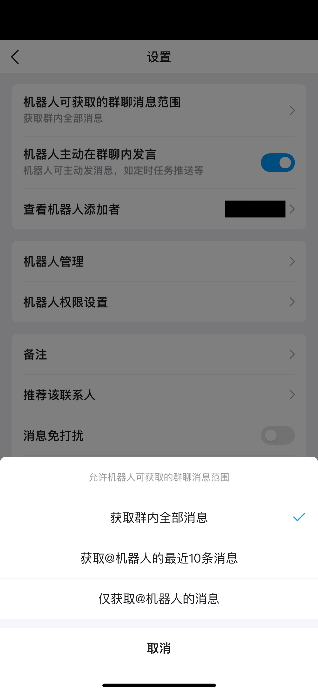
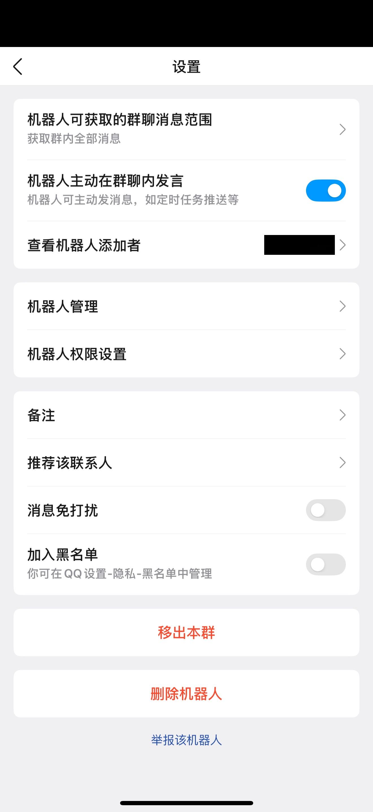

<div align="center">


**A QQ Bot plugin for [deepseek-harness](https://github.com/deepseek-ai/deepseek-harness) (dsh), connecting DeepSeek AI assistants to QQ private and group chats.**

[](https://www.npmjs.com/package/@tencent-connect/dsh-qqbot)
[](./LICENSE)
[](https://github.com/tencent-connect/dsh-qqbot)
[](https://bot.q.qq.com/wiki/)

<br/>

**[简体中文](./README.md) | English**

Scan to join the QQ group / channel

<table>
<tr>
<td align="center" width="50%"><br /><b>QQ Developer Group</b><br /><sub>Group 1: 1032635674 · Group 2: 1056948758</sub></td>
<td align="center" width="50%"><br /><b>QQ Developer Channel</b><br /><sub>Channel ID: 20dnumts4z</sub></td>
</tr>
</table>

</div>

## Architecture

```
QQ User → QQ WebSocket → dsh-qqbot → ctx.agents → dsh agent loop → LLM
                                 ↑                           │
                                 └── session/event ──────────┘
                                       (assistant reply → QQ sendMarkdown)
```

## Installation

### Method 1: Desktop install (recommended)

No command line needed — everything happens inside the app:

1. **Install**: click "Plugins" in the left sidebar → "Add plugin" → enter `@tencent-connect/dsh-qqbot@latest` → install and start now


2. **Connect**: avatar at the bottom-left → Settings → "QQ Bots" → scan the QR code with mobile QQ


Credentials are saved automatically after the scan; later launches need no re-scan.

### Method 2: Manual

```bash
# Add to a profile
npx @deepseek-ai/dsh plugin --profile qqbot add @tencent-connect/dsh-qqbot

# Start
npx @deepseek-ai/dsh --profile qqbot
```

On first launch, the plugin detects missing credentials and automatically starts the QR flow: a QR code is printed in the terminal → scan it with the QQ mobile app → credentials are saved to the profile, so subsequent launches require no re-scan.

In environments without the in-app binding page (pure CLI), set `QQBOT_BIND_OPEN_BROWSER=1` to additionally open a browser QR page as a fallback.


> **Note**: Upgrade to `0.4.0` or later for browser-link scanning, which avoids QR code misalignment in some terminals.

### Method 3: Local path

```bash
# Build
cd /path/to/dsh-qqbot
pnpm install && pnpm build

# Add to a profile (local path)
npx @deepseek-ai/dsh plugin --profile qqbot add /path/to/dsh-qqbot

# Start
export QQBOT_APPID="yourAppID" QQBOT_SECRET="yourAppSecret"
npx @deepseek-ai/dsh --profile qqbot
```

### Method 4: --patch dev mode

```bash
export QQBOT_APPID="yourAppID" QQBOT_SECRET="yourAppSecret"
npx @deepseek-ai/dsh web --patch /path/to/dsh-qqbot/cordis.dev.yml
```

## Configuration

| Config | Type | Default | Description |
|------|------|--------|------|
| `appId` | string | **required** | QQ Bot AppID (or via `QQBOT_APPID` env var) |
| `appSecret` | string | **required** | QQ Bot AppSecret (or via `QQBOT_SECRET` env var) |
| `provider` | string | `deepseek-official` | LLM provider name |
| `model` | string | `deepseek-chat` | Model name |
| `preset` | string | - | Agent preset id |
| `cwd` | string | `process.cwd()` | Agent working directory |
| `requireMention` | boolean | `true` | Whether group messages require @bot to trigger |
| `groupPrompt` | string | - | Extra system prompt for group chats |
| `directPrompt` | string | - | Extra system prompt for direct chats |
| `textChunkLimit` | number | `4500` | Max chars per message |
| `streaming` | boolean | `true` | Enable streaming output (always disabled in groups) |
| `sessionIdleTimeout` | number | `1800000` | Session idle timeout (ms), default 30 min; `<=0` disables eviction |
| `processingTimeoutMs` | number | `1800000` | Processing timeout (ms), aborts the current LLM call |
| `maxQueue` | number | `20` | Max concurrent queue length |
| `historyLimit` | number | `10` | Group history buffer size |
| `askTimeoutMs` | number | `300000` | Question timeout (ms), default 5 min (ask_user_question) |
| `showToolResults` | boolean | `false` | Show successful tool-call results (errors always shown) |
| `debug` | boolean | `false` | Debug mode |

### Access control (access)

| Config | Type | Default | Description |
|------|------|--------|------|
| `access.c2cMode` | `open`/`allowlist`/`disabled` | `open` | Direct-chat access mode |
| `access.c2cAllow` | string[] | `[]` | Direct-chat allowlist (user openid) |
| `access.groupMode` | `open`/`allowlist`/`disabled` | `open` | Group access mode |
| `access.groupAllow` | string[] | `[]` | Group allowlist (group openid) |
| `access.commandMode` | `open`/`allowlist`/`disabled` | `open` | Slash-command mode; the allowlist is checked per sender OpenID |

Slash commands share the same open / allowlist / disabled modes as chats: a message first passes the chat admission rules, then the command is authorized by sender identity. Approval and question buttons keep their own authorization. The command roster lives in a separate identity file, so switching the mode never drops the list.

All three rosters (direct chat, group, commands) support three ways to add members: **pairing codes**, **manual bulk-adding by OpenID**, and **copy/export**. Note that OpenIDs are not QQ numbers or group numbers; use a pairing code when the OpenID is unavailable.

- **Pairing code**: generate one in account settings and have the user send it to the bot in the matching chat. The same code admits multiple people; sending it in the wrong scene does not invalidate it.
- **Revocation**: after an identity is removed, pairing codes issued before the removal can no longer re-add it; re-authorization requires a fresh code.

The config API returns `config.accessRevision`; submit it together with `access` updates. If the roster or mode changed since your read, the update returns 409 instead of overwriting the newer grants.

### QQ group message scope and proactive messaging

Ask the group owner to open the bot's settings in the mobile QQ group. Set these permissions separately for each group.

| Mobile QQ setting | Behavior in DSH |
|---|---|
| Bot group message scope → Receive all group messages | QQ can deliver new messages that do not mention the bot. The workbench records them when the group is allowed and both receiving and saving messages are enabled for the conversation. In mention-only mode, ordinary messages can become recent context but do not start an Agent turn on their own. The workbench starts recording when messages arrive and does not backfill group history. |
| Allow the bot to proactively message the group | The bot can send when no usable reply reference is available. Manual workbench sends prefer a valid reply reference when one exists. Automatic delivery of web replies uses a separate bot setting. |




The phone status bar and the bot adder’s display name are masked.

### Proactive delivery (proactiveDelivery)

Turns triggered by QQ inbound always reply passively; service turns (e.g. schedules) are always pushed proactively. This only controls turns driven by non-QQ input (e.g. continuing a QQ session from the desktop):

| Config | Type | Default | Description |
|------|------|--------|------|
| `proactiveDelivery.externalTurns` | `off`/`c2c`/`all` | `c2c` | `off` never push; `c2c` push direct chats only; `all` push direct and group chats |

### Rich media (media)

| Config | Type | Default | Description |
|------|------|--------|------|
| `media.enabled` | boolean | `true` | Enable rich media understanding (image/video download + tool analysis) |
| `media.maxMB` | number | `200` | Max download size (MB) |
| `media.ttlHours` | number | `24` | Media lifetime (hours), 0 = never expire |

### Vision (vision)

| Config | Type | Default | Description |
|------|------|--------|------|
| `vision.enabled` | boolean | `false` | Enable vision (qqbot_describe_image tool) |
| `vision.provider` | string | - | Vision model provider (e.g. pi-ai) |
| `vision.model` | string | - | Vision model id (e.g. qwen-vl-max) |
| `vision.maxBytes` | number | `10MB` | Max image bytes |
| `vision.maxTokens` | number | `1024` | Max output tokens |
| `vision.timeoutMs` | number | `120000` | Vision call timeout (ms) |

### File sending (sendFile)

| Config | Type | Default | Description |
|------|------|--------|------|
| `sendFile.restrictPaths` | boolean | `true` | Enable path allowlist (media + cwd + extraRoots only) |
| `sendFile.extraRoots` | string[] | `[]` | Extra allowed root directories |

## Built-in Commands

| Command | Description |
|------|------|
| `/new` (aliases `/reset` `/clear`) | Start a new session (clear context) |
| `/compact` | Compact session history (replace old records with a summary) |
| `/model` | View or switch model |
| `/preset` | View or switch agent preset (applies to new sessions) |
| `/stop` | Abort the current generation |
| `/bot-ping` | Network latency test (transport & processing time) |
| `/bot-version` | View version info |
| `/bot-status` | View current session status |
| `/bot-help` | View all commands |

## Core Modules

```
src/
├── index.ts                    # Cordis plugin entry (async apply)
├── config.ts                   # Config schema
├── types.ts                    # Global types
├── setup.ts                    # Credential binding (QR)
├── gateway/                    # Gateway assembly
│   ├── bootstrap.ts            # Startup wiring (session/event listeners, etc.)
│   └── middleware-setup.ts     # Middleware chain config
├── transport/                  # Transport layer
│   ├── inbound.ts              # QQ inbound message → agent.followup()
│   ├── outbound.ts             # session/event → QQ sendMarkdown
│   ├── outbound-buffer.ts      # Streaming buffer
│   ├── streaming-writer.ts     # Streaming writer
│   ├── reply-target.ts         # Reply target resolution
│   ├── msgid-cache.ts          # Passive reply msgid cache
│   ├── reply-limiter.ts        # Passive reply rate limiter
│   ├── tool-presenter.ts       # Tool-call presentation
│   └── chunker.ts              # Markdown chunking
├── session/                    # Session management
│   ├── session-manager.ts      # QQ peer → Agent mapping
│   └── idle-evictor.ts         # Idle eviction
├── model/                      # Model routing
│   ├── model-resolver.ts       # Route resolution
│   ├── prefs-store.ts          # Per-peer preference persistence
│   └── settings-reader.ts      # settings.yaml read-only
├── features/                   # Interaction features
│   ├── question-channel.ts     # ask_user_question Q&A channel
│   ├── approval-channel.ts     # approval confirmation channel
│   └── answer-parser.ts        # Answer parsing
├── media/                      # Media
│   ├── vision-tool.ts          # Image vision understanding
│   ├── send-file-tool.ts       # Send local files
│   └── media-cleaner.ts        # Media TTL cleanup
├── middleware/                 # Middleware
│   ├── question-answer.ts      # Q&A answer handling
│   └── attachment.ts           # Attachment handling
├── shared/                     # Shared utilities
│   ├── utils.ts                # Common helpers
│   ├── scope.ts                # scope/peer extraction
│   └── send-helper.ts          # Chunked send
└── commands/                   # Slash commands
```

## Session Routing

sessionKey: `qqbot:${appId}:${scope}:${peerId}`; a UUID session id is minted for new sessions and persisted to `model-prefs.json`, resuming by the persisted id after restarts; pre-0.6 sessions keep their originally derived ids.

Resolution strategy: in-process reuse → persisted resume → fresh create.

## Design Principles

- **Pure Cordis plugin** — follows the dsh "Plugins, not loop changes" principle
- **Declarative dependencies** — `inject = ['agents']`, no direct coupling to other plugins
- **Session isolation** — one independent Agent per QQ direct user / group
- **Preset support** — mount presets (toolkits, prompts, etc.) via the `agent-presets` service
- **Idle eviction** — idle Agents are disposed after timeout to prevent leaks (proactive push still resolves the peer from the session mapping)
- **Markdown output** — replies sent as Markdown with code-block/table-aware chunking
- **Image understanding** — supports `qqbot_describe_image` vision to analyze images sent by users
- **File sending** — supports `qqbot_send_file` to send local files to users (path allowlist enabled by default)
- **Question interaction** — supports `ask_user_question` with inline keyboard buttons (mutually exclusive) or numbered replies, one question at a time with timeout
- **Approval confirmation** — supports `approval/request` to ask for user confirmation on critical actions via allow/deny buttons

## Local Development

```bash
# Install dependencies
pnpm install

# Build
pnpm build

# Dev mode (watch)
pnpm dev

# Debug via --patch
export QQBOT_APPID="xxx" QQBOT_SECRET="xxx"
npx @deepseek-ai/dsh web --patch /path/to/dsh-qqbot/cordis.dev.yml
```

## License

[MIT](./LICENSE)
