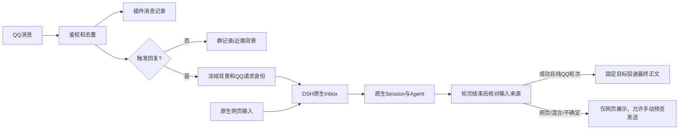

# dsh-qqbot 上游兼容方案

状态：已实现（本文记录设计决策与取舍依据）。

本方案替代依赖定制 Host 的原生工作台路线。仅修改 QQ 插件，兼容未修改的 DSH；共享记忆不进入本次范围。功能代码仅存在于插件仓库；运行验证使用未修改的 stock DSH 隔离实例。

## 1. 决策与验证基线

采用 **原生主 Session 页作为唯一编辑器，QQ 插件负责渠道身份、触发、权限和投递**。

- 私聊按联系人独立，群聊共享当前 Session。真正的提问、模型回答和工具事件由 DSH 正常持久化。
- 未触发的群消息保存到插件自己的有界记录，不伪装成原生 user/message。
- 网页默认使用原生输入框；QQ followup 与网页 queue 使用同一个原生 Inbox，不另造宿主队列。
- QQ 自动回复只在轮次成功结束、且确认本轮没有网页引导混入后发送最终文本。
- 模型、权限、工作区和输入体验优先沿用原生行为；Agent 预设变更通过新 Session 生效。
- 账号、每群策略、控制者与审批者、手机命令继续保留；权限执行必须适配原生 Agent 的恢复与子 Agent 生命周期。

核对基线：

| 对象 | 固定版本 | 核验方式 |
| --- | --- | --- |
| 未修改的本地 DSH | master，f3803c96974ad4a94195fb97e5c637e9c2a3afe3 | tracked 源码无改动；无关 tmp-delivery/ 保留 |
| 远端 DSH | ce7073d51254c26cd63b22a60835b8f948deb447 | 只读核对关键队列、Session、preset 和客户端接口；不是运行验收 |
| qq-bridge main | c893c7b59c5ba63f7c694464f48217598fa87591 | 读取固定提交源码；未安装、未启动 |
| 当前3198实验 | codex/qq-native-workbench 配套插件 | 已去记忆，但仍依赖定制 Host；不能作为本方案验收证据 |

不执行 Host 源码补丁、patch-package、原型改写、宿主服务方法替换、私有组件导入、宿主 Session JSONL 直接写入或实验事件接口。使用公开hook/Service扩展，而不是给宿主方法打运行时补丁。公开 API 仍是 pre-stable，后续实施需声明实际验证的版本范围；最新主干不是已经测试通过的发布版本。

## 2. 调研结论与取舍

### 2.1 原生输入与统一队列可以保留到什么程度

QQ 的 Agent.followup 与原生网页 queue 都进入同一 Agent 的 next-turn Inbox，每轮取一条普通输入，由同一个 driver 串行执行。顺序是实际入队顺序，不能承诺与平台网络到达顺序完全一致。

原生网页还支持 Steer：它进入 next-step，可被正在处理 QQ 的轮次领取。因此，“不能替换原生 submit”不等于“无法共用串行队列”；真正缺少的是任意原生输入的插件 sender override，以及自动替插件执行的逐轮渠道归属判断。

采用现有 Inbox，插件补充逐轮归属。保留原生输入、IME、附件、引用、草稿、失败恢复与原生 Queue/Steer，放弃透明接管所有原生输入的承诺。

前提是两侧必须取得同一个Agent实例。每次操作核对公共agents registry，缓存对象失效时重新获取；已有Session的冷恢复统一走公开sessionController.resolveAgent，不能继续向已被宿主替换的旧record.agent投递。

依据：[followup 与 steer](https://github.com/deepseek-ai/deepseek-harness/blob/ce7073d51254c26cd63b22a60835b8f948deb447/packages/core/agent-loop/src/agent.ts#L170-L188)、[Inbox claim](https://github.com/deepseek-ai/deepseek-harness/blob/ce7073d51254c26cd63b22a60835b8f948deb447/packages/core/agent-loop/src/inbox.ts#L102-L112)。

### 2.2 普通群消息不再要求写进原生日志

不使用自定义 channel/message、channel/admitted，不借用 system/message、user/message 或 inject 来保存被动消息。

- 未触发消息：插件群记录/近期背景。
- 触发提问及本轮实际使用的背景：通过正常 UserMessage 入原生 Session。
- 模型回答、工具调用和结果：原生日志。

因此，原生日志可以追溯模型实际看到了什么，但不再是全部群原文的唯一存储。普通群消息放“群记录”抽屉；首版不把两套数据伪装为同一种原生聊天节点，也不重写原生 transcript。

### 2.3 预设切换改为新 Session

上游 agentPresets.select 只允许首轮前选择。fork 沿用原 composition，不能通过 fork 后再 select 绕过限制。

更换预设时验证目标、创建新 Session，保留原工作区和旧历史，创建成功后再切换 QQ 当前映射。首版默认不自动总结或复制旧上下文；用户可以显式选择一份有来源、有限长度的交接说明，作为下一次真实输入的前缀。不得把它描述成原 Session 原地切换。

依据：[preset 选择限制](https://github.com/deepseek-ai/deepseek-harness/blob/ce7073d51254c26cd63b22a60835b8f948deb447/packages/preset/agent-preset-registry/src/index.ts#L345-L375)、[fork composition](https://github.com/deepseek-ai/deepseek-harness/blob/ce7073d51254c26cd63b22a60835b8f948deb447/packages/api/session-controller/src/commands.ts#L258-L275)。

## 3. 会话界面与工作区

### 原生主页面

左侧采用独立 QQ 导航模式，右侧沿用原生主聊天页。QQ 模式按群聊、私聊组织；返回工作区后恢复 DSH 原生导航。取消常驻的第二列 QQ 对话列表和第二套嵌入式编辑器。通过公开 `sidebar.workspaces` 扩展临时提供 QQ 导航，不修改宿主。

- Session 行通过公开 row trailing/hover 扩展显示 QQ 来源、群/私聊名称和是否当前 QQ 会话。
- 标题仅在创建时给合理默认值，例如“c++ · QQ 群聊”；用户原生重命名后不再被平台名称刷新覆盖。
- 本地联系人备注与 Session 标题分开保存。名称顺序为本地备注、有效平台名称、类型加短标识；不拿成员昵称当群名，也不猜测头像地址。
- 群或联系人行直接代表当前 Session，第二行显示有效标题与工作区短名称，不重复展示当前子卡片。展开列表初始显示5条历史 Session，更多按钮展开剩余历史。打开更旧的历史会话时展开列表，保证选中行可见；当前与历史只保留一个选中态。
- 普通 QQ 收信更新插件目录和来源提醒；不会自动更新原生 Session 活动时间。不能靠空 user/message 或重复 rename 刷排序。
- QQ 导航以联系人或群为父节点，其 Session 可分属不同工作区；每行显示该 Session 自身的真实工作区。联系人不是 Workspace，也不写入宿主工作区树。由于宿主无公开排除接口，QQ Session 仍可能出现在普通工作区树中。

QQ 入口切换到独立导航：搜索名称、备注或 Session 标题，查看待授权发现及账号状态。点击群或联系人，通过公开 uiWorkspace.openSession(currentSessionId) 在当前主页面打开当前 Session；箭头单独控制历史展开。尚未授权或尚无 Session 的条目打开管理详情，不向导航传空 ID、不隐式创建会话；需要创建时由用户显式选择“开始会话”。只有被动消息的对话不保证有原生 Session，不能用伪消息绕过原生空会话规则。

原生 Session 顶部公开 header.utilities 承载“QQ 设置”“群记录”“发送记录”；设置以抽屉打开。抽屉和发送预览捕获具体 Session/对话身份，切换页面不会悄悄换成新目标。菜单/抽屉通过 portal 或 shell.overlay 展示，避免标题区裁剪。

来源：[公开导航](https://github.com/deepseek-ai/deepseek-harness/blob/ce7073d51254c26cd63b22a60835b8f948deb447/packages/client/ui-workspace/src/client/navigation.ts#L40-L45)、[标题扩展](https://github.com/deepseek-ai/deepseek-harness/blob/ce7073d51254c26cd63b22a60835b8f948deb447/packages/client/ui-conversation/src/client/contract/slots.ts#L246-L256)、[五条基础规则](https://github.com/deepseek-ai/deepseek-harness/blob/ce7073d51254c26cd63b22a60835b8f948deb447/packages/client/ui-workspace/src/client/rows/WorkspaceBrowser.tsx#L54-L93)。

### 工作区、模型和权限

模型与权限保留原生输入区控件；DSH 所有者的网页操作遵循上游语义，QQ 控制者的手机操作走插件授权。每群工具/资源上限仍在执行守卫中检查，不能只靠控件限制。

已有 Session 的 cwd 不能因为换分组而悄悄改变。插件提供“切换工作区并新建 QQ 会话”：保留旧 Session，创建绑定目标真实目录的新 Session。用户手动新建的普通 DSH Session 不自动获得 QQ 外发资格。

历史 Session 标明不再是当前 QQ 会话。首版不宣称宿主强制历史只读；所有者若继续历史 Session，只产生本地工作，不自动重新绑定 QQ。

最新上游提供 contextMenus.register 的 session/workspace target，但首 PR 只使用两基线共有的标题入口和现有 Session 菜单扩展，不同时适配两代菜单框架，也不硬导入旧宿主不存在的新菜单包。后续若采用新接口，单独声明最低版本，不用私有组件回退。

来源：[最新菜单接口](https://github.com/deepseek-ai/deepseek-harness/blob/ce7073d51254c26cd63b22a60835b8f948deb447/packages/client/ui-context-menu/src/client/types.ts#L76-L117)。

## 4. 输入、背景与投递

### 4.1 被动消息与背景

接收、记录和自动回复分别配置；未放行的对话只保留发现所需身份，不存正文。仅记录平台实际推送的消息，不因本地开关承诺收到全群流量。

保留互动、近期背景和历史查询三种模式。默认背景同时限制最近10条、10分钟、4000字符。命令先解析鉴权，不进入普通背景；引用里的命令不执行。

每条触发冻结接收截止 cursor。背景从该截止之前、尚未实际入模的消息中选择；之后新到消息留待后续轮次。每群最多准备一个等待入模确认的 QQ 请求，避免多个排队请求重复预支背景；其他触发先保留为待准备操作。

消费 checkpoint 只根据匹配 QQ UserMessage 已真实写入并完成公开 flush 的证据推进。followup 返回、运行时 claimed 或 whenIdle 均不构成“模型已经看到”的证据。/new 设置新的背景起点，不自动把旧群记录重新带入。

近期背景未开启持久记录时不承诺跨重启恢复全部原文；群记录模式显式保存，默认保留7天，可按对话配置。清理插件群记录不会删除原生 Session 已经使用过的上下文。

### 4.2 按输入身份识别轮次

不能继续用“当前 Session 属于 QQ”“beginTurn 到 whenIdle”推断所有输出的去向。

QQ 请求先记录完整 UserMessage.id、规范化完整输入payloadHash（含正文及附件）、operationId、Session generation、策略版本、原始消息标识、背景引用与固定 reply target，再调用 followup。自动外发必须同时匹配消息ID、冻结的完整载荷与预期next-turn开场方式；不单凭ID或模型可见的source.qq字段授权。

原生编辑排队项会保留ID/source而修改content，移为Steer也可能保留同一消息。因此网页编辑、改为next-step、同一轮出现多个QQ操作或非预期开场，均撤销该轮自动外发资格；不能以“ID没变”认定仍是原QQ请求。

运行时 agent/inbox/claimed 可即时建立 message→turn 关系，但它不是 durable 事件。恢复与最终确认需读取公开 Inbox 状态、durable splice、实际 user/message 和 turn/start/end；user/message 本身没有 turn 字段，按轮次边界归属，assistant/message 则有 turn/step。

本轮出现任何未匹配QQ账本的人类输入，包括网页Steer，标记为混合轮次。监听缺失、来源不明或日志不完整时不自动外发。

追问可能通过tool/result或迟到的user-question-reply进入上下文，不能只检查kind:user。使用公开user-questions/request waterfall和approval/request，移除当前QuestionChannel对userQuestions.ask的直接替换。只有插件记录的(Session、turn、callId、nonce、actor)回执可证明QQ回答来源；未证明来源的自由正文回答将该轮判为混合。审批仍校验指定审批者及最新策略，不能改变授权上限。

来源：[claimed 运行时定义](https://github.com/deepseek-ai/deepseek-harness/blob/ce7073d51254c26cd63b22a60835b8f948deb447/packages/core/agent/src/runtime-types.ts#L318-L328)、[持久 splice](https://github.com/deepseek-ai/deepseek-harness/blob/ce7073d51254c26cd63b22a60835b8f948deb447/packages/core/agent-loop/src/inbox.ts#L214-L229)、[实际输入记录](https://github.com/deepseek-ai/deepseek-harness/blob/ce7073d51254c26cd63b22a60835b8f948deb447/packages/core/agent-loop/src/agent.ts#L459-L479)。

### 4.3 首版发送规则

| 输入/结果 | QQ行为 |
| --- | --- |
| QQ提问形成的成功纯QQ轮次 | 轮次结束后自动发送最终正文 |
| 普通网页 Queue 提问 | 网页展示，不自动发送 |
| 网页 Steer 混入QQ轮次 | 整轮不自动发送，网页显示原因和手动发送入口 |
| 取消、错误、未知归属 | 不发送模型正文；记录明确状态 |
| 用户点击完成回答的“发送到QQ” | 预览目标和正文，再显式投递 |

首版不自动外发流式文本、工具结果或文件，不向模型开放直接 QQ 发送工具。否则后到网页 Steer 无法撤回已经发送的内容。附件接收和原生网页上传仍可保留；文件外发以后按相同轮末判定另做。

网页输入仍进入共享上下文。“仅网页回复”表示本轮不自动外发，不是上下文隔离：后续 QQ 问答仍可能引用此前网页内容。真正私密的分析使用独立普通 DSH Session。

手动发送绑定源回答和目标对话，不在点击后重跑模型。使用稳定 deliveryId、内容hash和分片状态，区分待发送、发送中、接口接受、失败和结果未知。检查当前授权及 QQ 平台回复条件，过期时明确报错；未知结果不自动重发。

首版暂不提供“原生任意正文透明切换同时发送QQ”。后续可以增加公开 /qq 命令，保留原生编辑器并明确授权该次提问；这不是任意正文 sender override，也不属于首PR必需项。

## 5. 数据恢复、权限与命令

### 数据与恢复

DSH保存实际执行历史；插件保存对话目录、被动消息、请求账本和投递记录，不新增记忆服务或容器。

| 数据 | 关键身份和状态 |
| --- | --- |
| 对话 | 账号＋群/私聊标识、当前Session、generation、策略版本、备注 |
| 收信 | 对话内唯一平台消息ID、单调cursor、发言人、规范化正文/附件、触发标记 |
| QQ请求 | operationId、完整UserMessage/id、截止cursor、背景引用、固定replyTarget、queued/entered/mixed/settled |
| 上下文checkpoint | Session/generation、实际消费位置、对应原生user事件证据 |
| 投递 | deliveryId、turn、finalMessageId、目标、hash、分片状态 |

继续使用插件自有原子JSON与分组日志。消息与对应触发准备记录应以同一条可恢复记录写入，由该日志重建目录/索引；不依赖“先写消息JSONL、再改目录JSON”恰好都成功。明确每群单写者、完整记录提交与flush、尾部残写恢复。该本地提交与DSH enqueue不是跨存储原子事务，二者之间的未知状态按下面规则处理。配置、Session映射切换和投递同样明确提交点。日志损坏或磁盘写入失败时停止该对话的自动执行，不静默丢弃状态继续发送。

上述持久化只覆盖已获准保存的消息与触发请求；近期背景模式下未触发普通消息的正文仍可仅保存在有界内存中，不因引入操作账本而自动扩大保存范围。触发请求冻结的实际输入与引用单独受其处理记录策略约束。

恢复时：

1. 原生Inbox仍包含同一message ID：沿用排队项，不复制入队。
2. 原生日志已有同一真实输入：恢复对应轮次及背景消费证据。
3. 已离开Inbox但找不到真实输入：保留未知/阻塞状态，不自动重投。
4. 投递已处于sending但没有确定回执：恢复为unknown，不自动重发。
5. 观察日志/页面回放不触发新任务或外发。是否续跑原生排队项依照宿主恢复机制，不承诺插件重启自动唤醒全部任务。

### 每群权限

保留独立角色、工具规则、资源范围、控制者和审批者。工具目录过滤与执行守卫都要保留；模型/原生权限模式不能扩大群策略上限。

- 使用已有全局 agent/created 和工具执行hook，覆盖恢复、重建和同宿主子Agent；不只对最初创建的QQ Agent安装。
- 执行时按真实Session/祖先归属检查最新群策略。普通非QQ Session不被误套群策略。
- PTC nested调用经过同样守卫；run_code单独检查，不把隐藏schema当成执行禁止。
- 进程外子Agent provider无法确认继承时，不向QQ任务开放。
- 审批绑定具体群、调用、审批者和策略版本；通过后仍检查目录范围及最新授权。
- QQ发送资格独立于一般工具权限；“允许某工具”不意味着可以把网页轮次外发。

DSH网页所有者是本地管理者，不能承诺用插件UI禁止其调用宿主所有管理API。QQ侧成员和控制者的授权必须在插件服务端执行；网页原生操作遵循上游语义，实际工具执行仍受该QQ Session的策略上限约束。

### 命令

| 命令 | 语义 |
| --- | --- |
| /model | 改当前Session模型，保留上下文；QQ侧校验操作者与模型范围 |
| /permission | QQ侧查询/选择获准模式；工具守卫继续限制最终权限 |
| /preset | 验证新预设，创建新Session后生效；原会话保留 |
| /new、/reset、/clear | 新Session；不物理删历史，不重新加入旧背景 |
| /compact | 沿用原生压缩，不等于删原始日志 |
| /stop | 校验发起者/控制者/所有者，对齐原生Stop的keepInbox:true；停止当前turn但保留已排队项 |
| /status、帮助 | 查询当前映射、模型、预设、策略和任务/投递状态 |

原生网页的同名命令仍走宿主；它们不能被宣称自动等价于QQ对话映射管理。网页QQ“新会话/换预设/切工作区”使用插件专有入口，并与手机调用同一服务端操作。

## 6. 生命周期和迁移

首版保留手动换新，自动换新可沿用已有按天/消息量设置，但只在明确安全边界执行。旧Session不复制全量上下文，不自动总结。

暂缓物理删除历史和自动retention。上游无公开delete接口时，插件不得直接删Session文件；原生archive只是隐藏，不是清理占用。可以展示公开stat.sizeBytes可得的物理日志大小，不能冒充包含全部历史版本和索引的总占用。

迁移边界：

- 保留现有绑定、凭据、模型偏好和每群策略；不静默扩大已允许的保存或工具范围。
- 可靠映射且使用上游支持事件的旧Session才可继续恢复；不能按标题猜归属。
- 含定制channel/message或channel/admitted的实验日志继续留在旧实验profile，不直接搬进原生上游profile；兼容版为这些对话创建新的合法Session，保留历史查看说明。
- 已去掉的记忆配置/工具不再恢复，现存记忆数据不删除。
- 3198及其旧Host分支保留为实验记录，不部署日常、不把旧通过结果计入新方案验收。

## 7. 实施顺序与验收

### 第一单元：移除定制宿主依赖

改造inject/启动检查、依赖链接、channelMessages、admitPrompt/managed guards、preset.switch和storage.delete；删除客户端registerSessionSender/updateSessionControls/conversation.workbench等定制接口依赖。移除userQuestions.ask替换，改用公开追问与审批hook；修正Agent缓存身份检查和原生Stop参数。使用未修改上游的公开类型与包入口编译，声明实际支持版本。

完成条件：插件可在隔离profile通过安装与装配；Host tracked源码及补丁配置前后不变。不得用另一个带补丁的Host验证后声称兼容。

### 第二单元：请求归属和最终投递

被动记录、背景快照、逐消息/逐轮账本、混合轮次、最终投递和恢复。将当前按Session beginTurn/whenIdle路由改成真实输入ID与轮次证据；首版关闭自动流式及工具直发旁路。

完成条件：QQ/Web Queue交错、Web Steer、两网页客户端、取消/排队、claim后拒绝、重启及迟到结果均不误发；请求结果未知不重投。

### 第三单元：原生Session列表和QQ抽屉

原生主页面为唯一编辑器；左侧来源badge、当前会话导航、标题QQ操作、设置/群记录/投递抽屉及完成回答的显式发送。

完成条件：重命名、工作区、新旧会话、超过5条、长名称、明暗、窄面板、IME、附件、草稿和来回切换正常。尚未授权/尚无Session的目录项不会隐式启动Agent、错误导航或制造空会话。列表装饰共用目录快照，不为每行启动Agent或轮询。

### 第四单元：上游集成和真实QQ

按dsh-plugin-isolated-test使用未改源码/发布包、隔离Home/profile/QQ数据和工作目录。验证类型、插件回归、构建、包内容和全新profile安装；运行时验证与源码审计分别记录。

真实QQ只使用已授权的机器人私聊与c++测试群；可通过CUA发送。没有实际收到普通群消息时标为平台未验证，不拿合成事件代替。日常实例不变，不发布或推送。

验收必须包含：

- 两群/两私聊的模型、工作区、角色、工具和审批不串用；Agent恢复、重建、同宿主子Agent和PTC不绕过工具策略。
- 未触发消息不启动模型；真正触发只入队一次；背景cursor不因followup返回或whenIdle提前推进。
- QQ轮次运行时网页Steer、编辑QQ排队项、将QQ项移为Steer、同轮合并多个QQ操作或网页回答追问，均不自动外发；已排队但尚未被领取的下一轮网页输入不误伤已完成的纯QQ轮次。
- 原生Stop和QQ的/stop均保留已排队项，且被停止轮次不自动外发；取消某个排队项按独立操作处理。
- 普通网页任务、历史Session、原生新建Session、日志回放、插件重启不自动外发QQ。
- 已接受但不确定的请求、发送回执丢失、分段部分成功均有明确状态，不盲目补发。
- 新预设/工作区创建失败保留旧映射；旧Agent迟到结果不改变新会话或新目标。
- 插件未修改Host、没有fork链接/私有API/包补丁；新版本兼容性由真实隔离运行证明。

方案已经由客户端与运行时两条独立源码审计交叉复核；已修正旧版本菜单硬依赖、无Session目录导航、排队项编辑仍保留ID、追问方法替换和Agent缓存身份问题。该复核仅说明方案与所读接口一致，不代表实现或运行验收通过。

## 8. qq-bridge 借鉴范围

qq-bridge通过Web API创建并映射真实DSH Session；普通群消息由其自身recent/unread状态保存，唤醒后再提交prompt。它也会在模式/preset权限变化时退役映射并重建，历史留在DSH。可借鉴这种渠道映射和被动消息缓冲，不必先改宿主。

其普通chat转发按映射Session和turn结果处理，reserved2则不自动转发文本、由工具发送。该设计不能直接证明“网页和QQ共用Session时，网页输入不外发”；我们的逐轮来源校验、混合输入停止外发和结果未知状态需要单独实现验证。OneBot获取群信息/历史的能力也不能移植为官方QQ平台权限承诺。

源码：[Session创建与映射](https://github.com/Derpyu520/qq-bridge/blob/c893c7b59c5ba63f7c694464f48217598fa87591/src/bridge.js#L8352-L8455)、[被动消息记录](https://github.com/Derpyu520/qq-bridge/blob/c893c7b59c5ba63f7c694464f48217598fa87591/src/bridge.js#L10193-L10265)、[轮末转发分支](https://github.com/Derpyu520/qq-bridge/blob/c893c7b59c5ba63f7c694464f48217598fa87591/src/bridge.js#L12158-L12169)。
