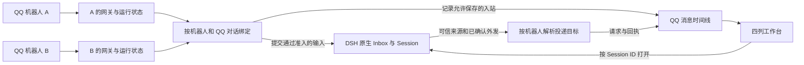

# 多机器人、QQ 对话与 DSH Session

讨论稿 v0.5 · 2026-11-05

同一个 DSH profile 可以运行多个 QQ 机器人。每个机器人独立连接官方 QQ 网关，独立管理接入、默认值、对话绑定和投递。每个 QQ 群或联系人可以有多个原生 Session，其中最多一个接收新的 QQ 工作。Coding、知识问答和角色聊天通过 DSH 预设、提示词与工具权限区分。

## 数据按机器人与对话归属

| 数据 | 唯一身份与所有者 | 约束 |
|---|---|---|
| 机器人 | 当前 profile 下的 AppID。插件账号目录拥有本地名称、启用状态与配置版本 | AppID 稳定。凭据单独处理，网页读接口不返回 AppSecret。运行代次区分重连、停用和换凭据前后的实例。 |
| QQ 对话 | AppID、群聊或私聊、该账号下的对话 OpenID。插件拥有对话设置和 Session 绑定 | 不按昵称、QQ 号、当前选中的账号或最近一条消息猜测。群成员 OpenID 用于署名、命令和审批。 |
| 原生 Session | DSH Session ID。宿主拥有正文、轨迹、工具结果、审批、实际工作区和运行状态 | 插件保存明确的当前绑定及历史关联。一个可接收的 Session 只能属于一个 QQ 对话。历史归属仅用于展示和授权回传。 |
| QQ 入站 | AppID、对话键、平台事件标识。插件保存关联及可选正文 | 去重和记录分开。真正提交 Inbox 时记录原生 `Message.id`，获得平台输入与原生回合的关联。 |
| QQ 外发 | AppID、对话键、稳定操作 ID。沿用 #118 的投递防重状态 | 状态与正文留存分开。接口接受、失败和结果未知如实展示。回执按提交时的账号和目标落账。 |
| 界面选择 | 浏览器中的机器人、对话、滚动位置与草稿 | 路由与权限来自服务端。切换选中项不修改接收绑定，也不改变进行中操作的目标。 |

每个机器人的网关有独立的回复 ID 缓存、限额、配对和待答状态。存储写入按账号隔离。媒体临时文件、清理范围和账号运行诊断同样按账号归属。用一个插件入口装配账号目录，并为每个已启用账号管理一个运行实例。工作台、HTTP 路由和共享 Host 工具各注册一次。工具调用由原生 Session 归属或经过验证的明确目标选择机器人。只有一个账号时兼容现有调用；多账号且无法唯一确定机器人时提示选择。

现有 `SessionManager` 已把 AppID 放进 peer key。需要收敛的地方是单账号绑定接口、从 profile 读取单个 `access` 的逻辑、模块级回复 ID 缓存，以及在每次网关启动时注册的 Host 工具。仅把旧插件启动多次会令这些状态继续共享。实现时逐项检查网关监听器、附件下载、投递账本、工具注册和 Session 正反向绑定。 [#118 网关组装](https://github.com/gosomea/dsh-qqbot/blob/79693845a600d2e023cda917d89d5e9240690dcc/src/gateway/bootstrap.ts) · [回复 ID 缓存](https://github.com/gosomea/dsh-qqbot/blob/79693845a600d2e023cda917d89d5e9240690dcc/src/transport/msgid-cache.ts) · [单账号配置接口](https://github.com/gosomea/dsh-qqbot/blob/79693845a600d2e023cda917d89d5e9240690dcc/src/shared/bind-protocol.ts)

## QQ 入站如何变成 Agent 工作

1. 官方 QQ SDK 收到事件。配对码走本账号的独立控制路径。普通消息先核对运行代次、账号接入和对话接收状态。
2. 已准入的事件去重后进入可选的 QQ 记录。群聊未触发的消息可以在记录里显示。官方网关没有推送的事件无法记录。关闭正文记录只改变记录范围，模型已经使用的内容由 DSH 管理。
3. 根据实时的群 @ 规则、斜杠命令开关和既有审批流程分派事件。触发 Agent 的消息按对话排队。出队和提交 Inbox 前复查准入，再解析当时有效的当前 Session。
4. 需要新建时，校验工作区、预设、模型和权限后创建。拿到可用的原生 Session ID 才原子更新映射。相同请求用相同操作标识，重试复用结果。创建失败继续保留原绑定。用户主动换新时，如果还有运行中或排队的工作，提示等待空闲，避免正在执行的任务突然切到另一个项目。
5. 用 #118 的入口登记平台身份与 DSH `Message.id` 后提交 Inbox。宿主负责调度、组装模型请求、工具和审批。补充提示词在下一轮组装。工具撤销在实际执行时复查，等待审批的工具获准后仍检查当前限制。 [原生 Agent 接口](https://github.com/deepseek-ai/deepseek-harness/blob/f3803c96974ad4a94195fb97e5c637e9c2a3afe3/packages/core/agent/src/runtime-types.ts#L233-L260)

## QQ 外发如何获得资格

- **QQ 发起的回合。** #118 根据登记的输入确认来源，使用提交时固定的机器人、对话与平台回复目标。群聊和私聊沿用已有 SDK 的回复方式。流式、工具过程、文件和卡片通过同一账号与当前授权校验。混入网页输入后，阻止后续自动外发。先前已经提交的请求保留实际结果。
- **网页发起的回合。** 纯网页输入按对话有效的主动推送设置处理。打开历史 Session 不赋予 QQ 自动发送资格。现有内部回合行为继续遵循 #118 的来源策略及账号、对话准入，工作台不创建新的定时任务入口。
- **手动回传。** 从原生回答发起预览。服务端根据 Session 与回答引用确认 QQ 归属并读取内容。确认项绑定账号、对话、操作者、正文摘要和有效期。确认时复查准入与目标，再复用 #118 的提交防重。已完成操作回读状态。结果未知时显示核对提示，由操作者决定是否发起一次新操作。被动窗口失效时按现有主动发送资格显示可用方式或失败原因。

在 QQ 消息页用同一个分页查询展示收发。原生回合引用只在存在已验证的关联时提供。游标按对话和稳定顺序查询，状态更新保持气泡位置。消息记录与外发幂等分别维护，清除正文不释放已提交的操作标识。

## 宿主接口与降级

新工作台的 HTTP 接口由 DSH 的 `connection.fetch.register` 注册到 `/api/qqbot/workbench/`。Host 验证连接来源、认证和 owner 身份。账号查询只返回 AppID 与连接状态。旧宿主未提供该接口时保留旧的绑定与配置入口。

宿主公开席位切换原生主区。工作台从 `sidebar.panellist` 返回时恢复浏览器里的选中项与草稿。原型顶部标签用来演示切换顺序，宿主接入以目标版本公开的主区导航为准。

| 需求 | 采用的 DSH 能力 | 需要单独验证 |
|---|---|---|
| 工作台入口和设置 | 现有插件主区与 `sidebar.panellist`，复用主题和组件 | 四列主区尺寸、固定设置栏折叠、窄屏内页以及原生 Session 返回。 |
| 打开当前或历史 | `uiWorkspace.openSession` 与原生 Session 选择、投影 | 原生消息精确定位的公开接口。缺失时打开所属 Session 并显示可复制的引用。 |
| 预设、目录、模型和推理 | 原生工作区、Agent preset 注册表与会话级模型能力 | 已开始预设的锁定规则。会话级模型接口是否改写宿主默认。存在副作用时只保存 QQ 下次偏好。 |
| 自定义工具 | DSH 原生执行器、会话作用域的 `tools.setExecutor` 和 `tools.guard` | 工具清单同时限制模型请求和执行，仍受原生权限及审批约束。没有可恢复的执行器覆盖接口时，仅标准模式可选。派生 Agent、计划任务和修改插件等入口不进入自定义目录。 |
| 原生答复回传入口 | 目标发行版公开的会话或回答扩展点 | 缺少回答级插槽时，用插件面板选择同一个 Session 的完整回答预览，仍走服务端授权。 |

工具有效范围是预设实际装配的工具、QQ 允许的工具、原生沙箱与审批约束的交集。工作区表示执行位置。文件范围还需由宿主沙箱和真实路径校验兑现。普通 DSH Session 按宿主原有流程执行。 [原生导航](https://github.com/deepseek-ai/deepseek-harness/blob/f3803c96974ad4a94195fb97e5c637e9c2a3afe3/packages/client/ui-workspace/src/client/navigation.ts#L34-L48) · [工具限制](https://github.com/deepseek-ai/deepseek-harness/blob/f3803c96974ad4a94195fb97e5c637e9c2a3afe3/packages/core/tools/src/index.ts#L155-L187) · [执行守卫](https://github.com/deepseek-ai/deepseek-harness/blob/f3803c96974ad4a94195fb97e5c637e9c2a3afe3/packages/core/tools/src/index.ts#L380-L401)

## 单账号迁移到账号目录

读旧绑定，按原 AppID 导入一个账号，保留 Session ID、凭据来源、OpenID、命令与接入策略、媒体与记录配置、已有偏好。旧共享文件只导入能核实归属的条目。有旧 Session 偏好但存储缺失时保留待核验映射。迁移写入一次性标记，重启再次读取不会覆盖新版设置或回放投递。切换到另一个 AppID 时使用独立数据。第一阶段使用 #113 的旧配置与会话样本验证升级，再接多账号并发。

[产品布局](design.md) · [配置如何生效](routing.md) · [实施与验收](plan.md)
