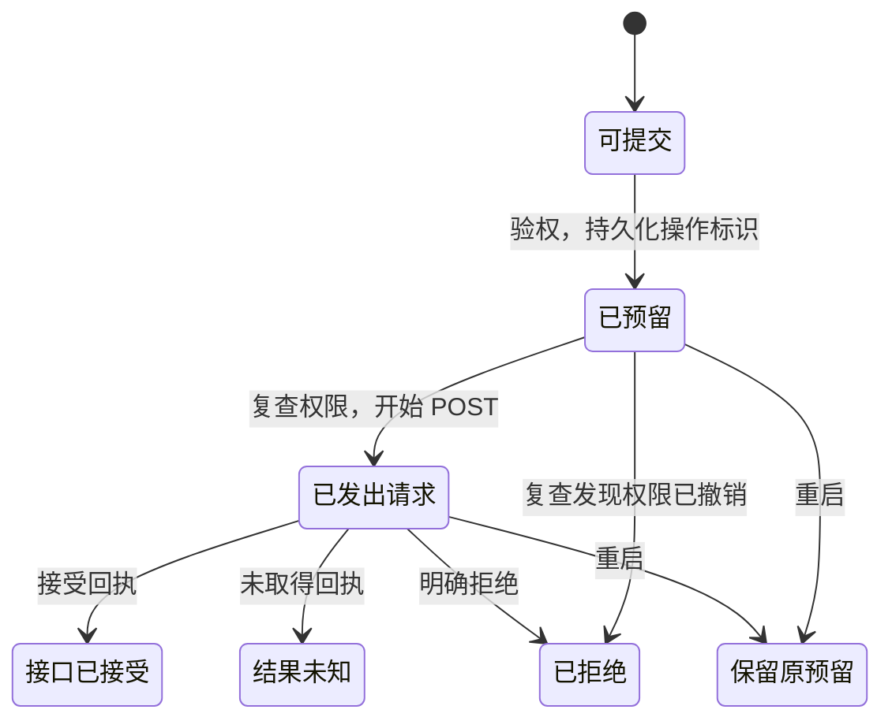

# QQ 手动发送模型

这份 TLA+ 模型描述一次发送操作从预留标识，到发出 QQ 消息 POST，再到记录回执的过程。对应实现见 [manual-send.ts](../../../src/transport/manual-send.ts) 和 [delivery-ledger.ts](../../../src/transport/delivery-ledger.ts)。运行入口见[测试指南](../../../TESTING.md)。

重复提交只读取现有账本。图中的“保留原预留”表示重启后不会继续先前的网络请求；账本丢失属于下面单独检查的故障。

| 配置 | 检查什么 | 预期结果 |
| --- | --- | --- |
| `normal.cfg` | 账本完好；允许复查前撤权、重启、重提同一操作及丢回执 | 通过下列四条不变量 |
| `no-post-check.cfg` | 人为关闭发 POST 前的权限复查 | `Reserve → Revoke → SubmitPost` 违反 `OnlyAuthorizedPost` |
| `ledger-loss.cfg` | 允许停机期间账本缺失 | 一次 POST 后失去账本，再次提交会违反 `OnePostPerOperation` |

模型检查的四条不变量：

- `OnlyAuthorizedPost`：开始 POST 时仍有发送权限。
- `OnePostPerOperation`：同一操作最多开始一次 POST。
- `AcceptedRequiresPost`：标记接口已接受之前必须开始 POST。
- `PostFollowsReservation`：开始 POST 时已有持久化的操作预留。

模型只取一个机器人、一个目标和一个操作，计数最多走到第二次 POST，足以暴露这个操作的重复发送。权限判断和请求开始合并为一个动作。模型不推断已发出的网络请求能被撤销，也不验证平台送达、跨机器人隔离、分段上传和磁盘原子性。

账本丢失诊断使用三次独立 Node 进程重提同一个操作，通过本地 HTTP 服务直接数 POST。第一次成功后，账本完整时重提仍只有一次 POST；移走账本后，目前会出现第二次。这是已知的持久化边界，测试使用虚拟凭据，不连接 QQ。

优先通过 `src/transport/manual-send.test.ts` 验证实际代码中的撤权和防重。模型约束状态转换，代码回归核对实现，真实 QQ 收发另验。
