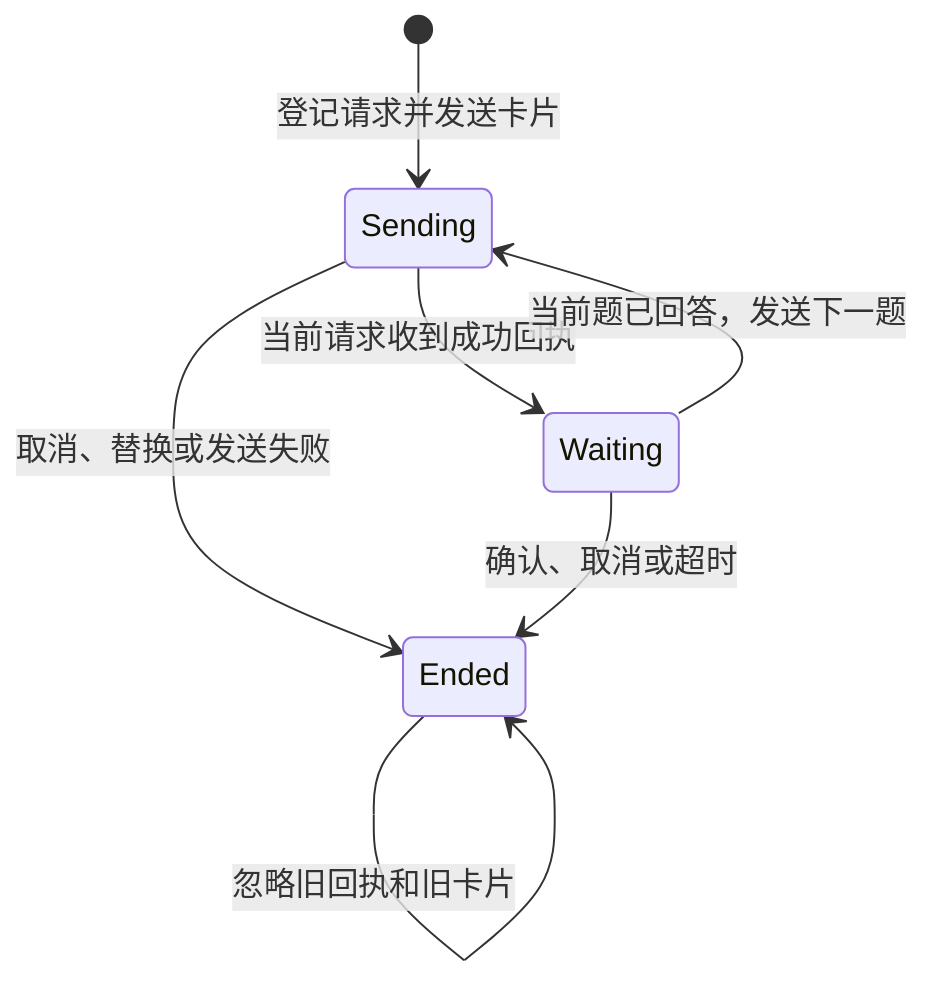

# QQ 审批与提问的请求生命周期

同一 QQ 会话只保留当前请求。发卡开始时登记请求，发送回执只更新当时登记的同一个请求。取消、换 Session、网关停用或提问超时立即结束等待。替换请求后，旧卡即使已出现在 QQ，也不能作答。

TLC 在一个 QQ 对话中分别运行审批和提问，最多两个请求、每个提问最多两题。模型交换发卡、回执、取消、换 Session、卸载和点击的顺序，并允许第二题发送途中超时。图省略了具体题号、Session 切换和卸载分支。审批取消由宿主信号或插件生命周期触发；提问另有自己的计时器。模型检查卡片与请求的绑定，文本作答没有按钮令牌，按当前题处理。QQ 平台显示卡片的实际时机以及账号权限属于集成测试范围。

| 负对照 | 违反的约束和最短反例 | 代码回放 |
| --- | --- | --- |
| `unchecked-receipt.cfg` | `CurrentIsLive`。A 发卡 → B 取代 A → A 回执晚到 → A 重新成为当前请求。 | 暂停 A 的发卡 Promise，让 B 先进入等待，再放行 A。旧代码的审批和提问都错误接受了 A 的按钮。取消、换 Session 和停用另有回归。 |
| `reused-token.cfg` | `OnlyCurrentCardAnswersOnce`。旧卡和新卡复用同一令牌 → 点击旧卡回答了新请求。 | 让宿主复用提问调用 ID。旧代码接受旧卡；现在按钮令牌每张卡独立，投递账本仍使用原有的去重键。 |
| `unchecked-submission.cfg` | `WaitingHasSentCard`。发送器报告跳过提交 → 审批仍进入等待。 | 让发送器返回 `false`。现在直接结束审批并返回 `unavailable`。 |

在仓库根目录运行 `pnpm verify:formal` 检查模型及负对照。用 `pnpm test src/features/approval-channel.test.ts src/features/question-channel.test.ts src/session/session-manager.test.ts` 回放插件代码。Java 与 JAR 的设置见[测试指南](../../../TESTING.md#形式化检查)。
