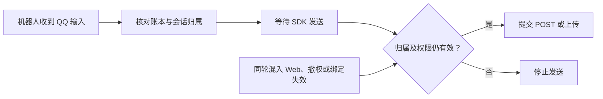

# QQ 入站归属与出站准入

QQ 入站收据按机器人分账。认领必须匹配 QQ 对话、Session、消息 ID 和正文，并记录首次认领的回合。出站绑定该账号、对话与回合。真正发包前重新检查当前绑定、回合来源和接入权限。



TLC 检查两个机器人共享 OpenID 和平台消息 ID、每台一次 QQ 入站、一个在途投递。每台均可收到 Web 输入或被撤权。机器人 A 可替换一次尚未结束的回合。模型同时检查纯 Web 推送允许和禁止的情况。已经提交的请求视为已发生，后来混入 Web 或撤权只阻止下一次提交。独立斜杠命令、配对回复及手动发送由各自流程准入，SDK 协议和 COS 分片由回归测试覆盖。

| 负对照 | 违反的约束 | 代码回放 |
| --- | --- | --- |
| `foreign-bot.cfg` | `PostStaysInAccount`。B 使用 A 的发送目标。 | 两个实际 SDK 实例使用相同 OpenID 和 QQ 消息 ID。旧代码让 B 发文本、流式帧及上传，修复后全部拒绝。 |
| `mixed-post.cfg` | `MixedDoesNotPost`。QQ 或 Web 单一来源排队后，另一来源加入同一回合。 | 等待 SDK 令牌时插入另一来源，验证文本及上传都未抵达请求层。临时关闭发送前的混合来源检查可复现泄漏。 |
| `revoked-post.cfg` | `RevokedDoesNotPost`。在提交前撤销接入。 | 回环 HTTP 回放复现兜底回复越过撤权、配对确认被拦后再发提示，以及 307 自动重发文本和上传。正常代码撤权后不发新请求，COS 重试也有独立回归。 |
| `stale-binding.cfg` | `PostRequiresCurrentBinding`。任务排队后，原回合被替换或绑定失去唯一归属。 | 旧代码会继续发送或上传。恢复旧 Session 和复用内存中的 Session 前均检查归属，已排队的文件工具也不能借同一对话的新回合恢复权限。 |
| `wrong-peer.cfg` | `ClaimStaysInPeer`。用另一个群、私聊或 OpenID 认领收据。 | Session、消息和正文相同时更换目标，确认拒绝认领，原对话仍可正常认领。 |

回环 HTTP 测试使用真实 QQ SDK 与本地服务器。未接入对话的配对结果是单独授权的文本回复，范围限原对话及本次配对处理。

运行 `pnpm verify:formal` 检查模型和负对照。用以下命令回放代码，环境设置见[测试指南](../../../TESTING.md#形式化检查)。

```sh
pnpm test src/transport/delivery-safety.test.ts src/transport/qq-delivery.test.ts src/gateway/bootstrap.test.ts src/session/session-manager.test.ts
```
