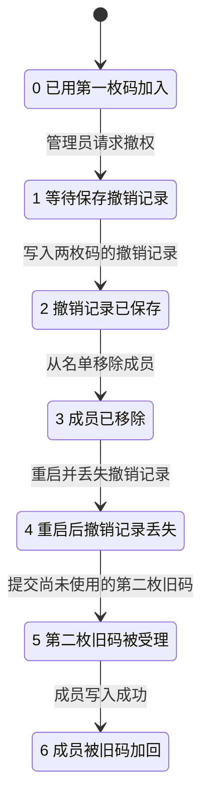

# 配对码认领与撤权模型

模型只取一个机器人、一种名单用途、一个成员和两枚码。成员写入与认领回执分开，撤销记录与成员移除也分开。TLC 可在两次写入之间安排失败或重启。每个请求的写入步骤在当前进程同步执行，重启保留此前已经落盘的状态。[实际写入顺序](../../../src/runtime/account-service.ts)

| 配置 | 要检查的行为 |
| --- | --- |
| `normal.cfg` | 从空名单开始，尝试签发、换码、结束或到期、认领和撤权。成员只有在名单写入成功后才收到认领成功，管理员只有在成员移除后才收到撤权成功，撤权前签发的码不能把成员加回名单。 |
| `forget-fence.cfg` | 第一枚码已经认领成功，第二枚码仍有效但尚未使用。人为让重启丢掉撤销记录，TLC 必须找到 `NoOldCodeReadmission` 的反例。 |

下面只画负对照的最短路径。编号对应 `statechart` 报告，省略未进入反例的写入失败、码到期和重试分支。



真实代码回放在临时目录里用第一枚码加入成员，签发第二枚码，执行撤权，再重建服务实例。保留撤销记录时，第二枚码仍有效，但该成员无法认领。负对照只恢复撤权前的配对文件，保留已移除成员的名单。第一枚码还有认领回执，仍会被拒绝；第二枚码没有回执，丢失撤销记录后会把成员加回名单。[回放测试](../../../src/runtime/account-service.test.ts)

模型把两枚码当作唯一标识，按请求验证时判断有效期。随机码值复用、同一请求内跨越过期时间、多个进程同时写文件、断电后的文件系统持久性和真实 QQ 接入均在本模型范围之外。

从仓库根目录运行模型和回放。环境变量设置见[测试指南](../../../TESTING.md#形式化检查)。

```bash
pnpm verify:formal
pnpm test src/runtime/account-service.test.ts src/runtime/pairing-service.test.ts src/runtime/pairing-state.test.ts
```

已安装 `statechart` 技能时，可以在临时目录生成负对照图和报告。该命令发现预期反例时返回 1。

```bash
pairing_work=$(mktemp -d)
cp tests/formal/qq-pairing/{QqPairing.tla,forget-fence.cfg,view.mjs} "$pairing_work/"
cd "$pairing_work"
statechart QqPairing.tla --config forget-fence.cfg --view view.mjs --out report
```
