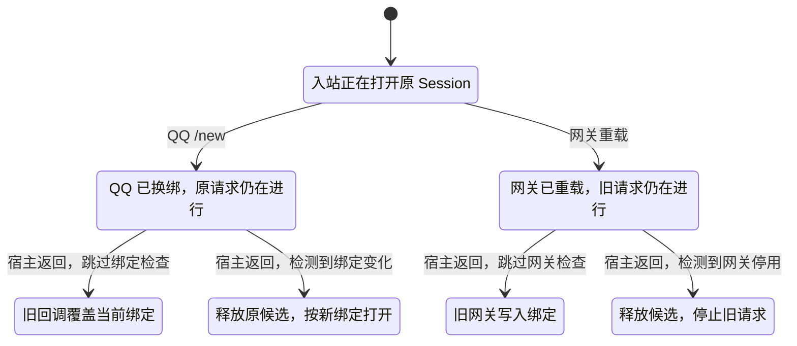

# QQ Session 切换模型

模型包含一个 QQ 对话、原 Session、QQ `/new` 预留的 Session 和一个 Web 候选。宿主打开 Session 和写入当前绑定是两步。模型允许一次网关重载和一次设置变更，并保留旧网关里尚未返回的宿主请求。

| 配置 | 要检查的行为 |
| --- | --- |
| `normal.cfg` | 入站恢复只提交当前绑定。网关停用后，它的请求不能再提交。活跃 Session 与已落盘绑定一致。Web 候选先由宿主保存，再核对设置和当前绑定并提交。 |
| `no-binding-check.cfg` | 关闭入站恢复对当前绑定的核对。`NoStaleBindingCommit` 找到 `/new` 已生效、旧恢复随后写回绑定的反例。 |
| `no-runtime-check.cfg` | 允许旧网关继续提交。`NoRetiredRuntimeCommit` 找到重载完成后旧请求仍能写入的反例。 |

下图只画两条反例和相应的修复路径，省略 Web 新建、设置变更和清理分支。



代码回放暂停宿主的恢复或创建请求，再执行 `/new` 或停用旧实例。旧版在这两个顺序都会写回旧绑定。修复版在 `/new` 后打开新绑定。重载后，无论新实例通过 QQ 还是 Web 换绑，旧网关返回的候选都会被释放。测试也验证了换绑写入失败时原 Session 仍可用，以及旧句柄清理失败时已完成的换绑仍然有效。[回放测试](../../../src/session/session-manager.test.ts)

释放候选是关闭其 Agent 句柄，宿主此前已保存的 Session 可能仍在历史里。模型关注当前绑定，范围不包括多个独立进程同时写同一文件、磁盘回滚、入站取到句柄之后的消息投递，以及模型切换时的 fork 细节。

从仓库根目录运行。环境变量见[测试指南](../../../TESTING.md#形式化检查)。

```bash
pnpm verify:formal
pnpm test src/session/session-manager.test.ts src/gateway/bootstrap.test.ts
```
