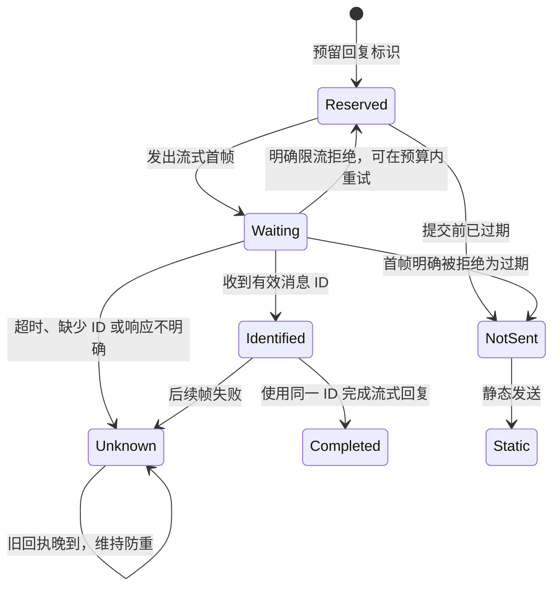

# 流式回复与静态回退

同一个逻辑回复只走一条投递路径。静态文本可按长度拆成多段。首帧结果未知时，停止创建新消息并保留发送账本；正常续帧使用首帧回执中的消息 ID。只有确认流式消息未发出，且对话仍获准接入，才允许按现有规则静态发送。



图省略重复事件、撤权、运行实例替换，以及从未尝试流式时的直接静态发送。模型检查一次回复、至多两次首帧提交、一次静态发送、一次撤权及一次实例退役。平台是否接受和本地是否收到回执独立推进。静态发送抽象为一条回复，确认的限流和过期响应表示该次 POST 被拒绝。续帧只更新已识别的同一消息。存储丢失由[手动发送模型](../qq-delivery/README.md)覆盖；SDK 的分片节流、平台回执格式和手机渲染由协议或端到端测试覆盖。

| TLC 配置 | `AtMostOneReply` 最短反例 | 代码回放 |
| --- | --- | --- |
| `normal.cfg` | 所有有界状态通过 | 本地真实 SDK HTTP 回放在等待回执、超时和回执晚到时都只观察到一个 POST。 |
| `no-opening-id.cfg` | QQ 接受首帧 → 回执缺少 ID → 下一帧再次开流 → QQ 接受第二帧 | 旧代码提交两次流式请求。修复后在首帧报结果未知，流水也显示结果未知。 |
| `no-rate-limit-status.cfg` | 首帧收到结果不明的限流错误 → QQ 仍可能接受 → 重试首帧也被接受 | 旧代码收到带限流业务码的 502 后仍重试；若重试返回过期，还会发送静态文本。修复后两种情况下都只提交首次请求。 |
| `no-unknown-fence.cfg` | QQ 接受首帧 → 本地超时 → 静态发送 | 在临时副本中移除结果未知的回退拦截，本地 HTTP 回放观察到额外静态 POST。正常代码恢复账本后也拦住重复开流。 |

实现位于 [QQ SDK 发送](../../../src/transport/qq-delivery.ts)和[发送账本边界](../../../src/transport/delivery-context.ts)。在仓库根目录运行以下命令，Java 和 JAR 路径见[测试指南](../../../TESTING.md#形式化检查)。

```sh
pnpm verify:formal
pnpm test src/transport/qq-delivery.test.ts src/transport/delivery-safety.test.ts src/transport/timeline-observer.test.ts
```
