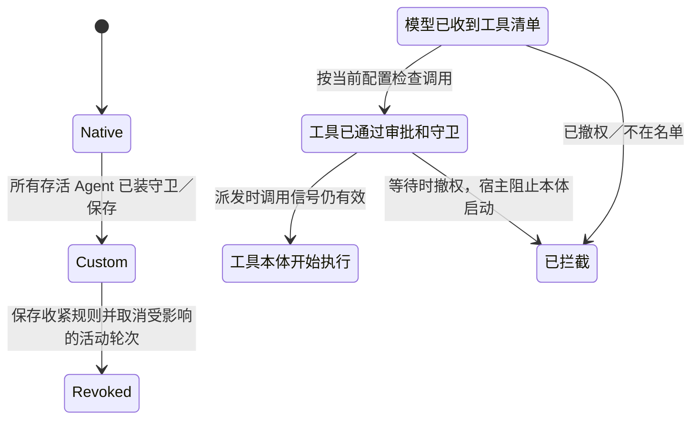

# QQ 自定义工具：安装、撤权与派发

自定义名单限制当前 QQ 会话及其宿主内子 Agent。真正提交给模型的 schema 取宿主此次实际定义和 QQ 名单的交集；原生权限高于设置的基础上限时，清单为空。Host 负责原生沙箱和审批，插件的守卫只会追加拒绝。

| 模型状态 | 代码边界 |
| --- | --- |
| 存活 Agent、归属、守卫 | `WorkbenchToolPolicies` 通过 live Agent 实例跟踪关系；冷恢复走原生 Session 的持久化父链。启用前复查当前根与子 Agent 均已装好限制。旧实例离开不等于新实例已安装。 |
| 模型请求 | 自定义执行器把过滤后的定义交给原生执行器。PTC 预设采用同一原生路径，`run_code` 不可用。 |
| 通过检查、等待派发 | Host 在审批后执行 `tools.guard`，之后仍可能异步等待落盘。工具白名单在 guard 内按当前配置重读。 |
| 配置收紧 | 成功保存后同步取消受影响的运行中 Agent，保留待处理输入。Host 在实际工具本体开始前检查原调用的取消信号。 |
| 工具已开始 | 已发生的副作用保留；插件不承诺回滚，运行中的工具按宿主取消契约收尾。 |

模型有两个 Agent、三种配置以及一次待处理调用。覆盖首次开启限制、活动中收紧、Agent 重开与守卫不齐。保留三组故障变体：不跟踪子 Agent、撤权时不取消已通过检查的调用、守卫没装好就发布。三个变体都必须触发指定的不变量。

用 [隔离 Host 回放](../../../TESTING.md#隔离-host-回放自定义工具)验证模型请求、宿主真实工具和磁盘副作用。模型不替代宿主沙箱或第三方工具的能力验证。允许的 shell、外部服务或自定义工具仍可能具有自己的副作用；该名单控制 DSH 工具入口，不能当作任意工具内部行为的沙箱。宿主需要支持 Agent 枚举；PTC 自定义工具还需要公开的可恢复执行器覆盖能力。
